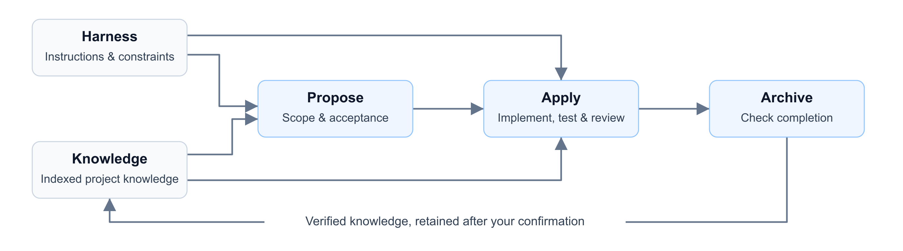
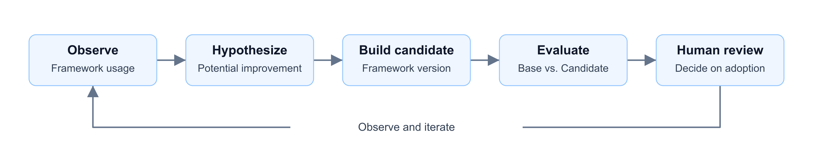

# AegisHarness

**English** | [简体中文](README.zh-CN.md)

> **Built to Adapt. Designed to Evolve.**
>
> Your team's engineering DNA, carried into AI development.

**AegisHarness helps your team build its own AI coding harness on Codex, Claude Code, MiniMax Code, WorkBuddy / CodeBuddy, Qoder and DeepSeek Harness (dsh).** It brings your business knowledge, engineering rules and development workflow into the agent's work—from requirements through implementation, tests, review and archive. Verified lessons stay with the project, ready for the next feature.

Start with the plugin. When you want to improve the harness itself, the optional **aegisharness-platform** lets maintainers observe usage, compare framework versions and evaluate candidate improvements before adopting them.

**9 commands · 6 hosts (Codex / Claude Code / MiniMax Code / WorkBuddy / Qoder / DeepSeek Harness) · Single repo / multi-repo Workspace · Apache-2.0**

[Quick start](#quick-start) · [The name](#the-story-behind-the-name) · [Why AegisHarness](#why-aegisharness) · [Framework iteration platform](#a-platform-for-iterating-on-aegisharness) · [User guide](docs/user-guide.md)

## The story behind the name

Every team has its own way of building software: the business rules it protects, the architecture it works within, the checks it trusts and the lessons it has learned. Together, these form its **engineering DNA**.

**Aegis** is the shield that guards what a team has learned: business rules, architectural boundaries and hard-won lessons, carried forward and refined over time. **Harness** gives that knowledge a role in execution—the context, constraints and workflow that guide a coding agent through real project work.

Forged from real-world engineering practice, AegisHarness brings these ideas together as a company-standard, host-neutral development harness. Project knowledge and rules help it adapt to your team; verified lessons retained at Archive give later tasks a stronger starting point. For framework maintainers, observations and controlled evaluations inform the next change, with adoption kept in human hands.

**The code ships. The knowledge stays. The harness evolves.**

## Why AegisHarness

| Capability | What it means in your project |
| --- | --- |
| **A Harness grounded in your project** | Repository instructions and indexed project constraints give the agent concrete engineering rules to follow during planning and implementation. |
| **Knowledge that compounds** | Stable, verified business rules, interface boundaries and implementation lessons can be recorded at Archive after your confirmation, then reused in later tasks. |
| **Context loaded when needed** | Harness and knowledge indexes guide which documents to load for the current requirement, task or archive step. The agent revisits context as the work changes. |
| **An inspectable development lifecycle** | Propose defines scope and acceptance; Apply implements, tests and reviews; Archive checks completion and records the outcome. Specs, tasks and evidence remain in the repository. |
| **Continuity across sessions and repositories** | Persisted workflow state supports resuming unfinished work. A multi-repo Workspace records repository responsibilities and coordinates work across services. |

Here, **Harness** means the project constraints and execution rules that guide the agent: what to read, which boundaries to respect and what evidence is required to finish. See the [context loading protocol](aegisharness/reference/loading-protocol.md).



### Your engineering DNA, made actionable

**Turn team experience into context your agent can use.** AegisHarness organizes project knowledge, engineering constraints, requirements and checks alongside your code, so they can be reviewed, reused and updated as the project evolves.

| Part | The question it answers | Where it lives in your project |
| --- | --- | --- |
| **Knowledge · Project understanding** | How does this system work? Which business rules and past decisions matter? | `docs/knowledge/` |
| **Harness · Engineering constraints** | Which development rules and architectural boundaries must the agent respect? | `docs/harness/` |
| **Specs · Task contracts** | What are we building, and what evidence will demonstrate completion? | `docs/specs/` |
| **Hooks · Checks and gates** | Which checks apply at key execution and review stages? | `docs/hooks/` and host hook configuration |

Knowledge and Harness indexes guide context loading. Specs hold each task's scope, plan and verification evidence. Hooks combine host runtime hooks, workflow gates and review checklists; their execution depends on the host and workflow configuration. See the [context loading protocol](aegisharness/reference/loading-protocol.md) and [hook setup](docs/installation.md).

### What knowledge reuse looks like

Suppose a refund feature establishes a state transition rule and a cross-service interface boundary. After implementation and verification, Archive proposes the stable knowledge to retain, and you confirm the update. When the next refund-related feature starts, Propose and Apply can load that knowledge through the index, giving the agent an existing project reference to work from.

Knowledge accumulates as **reviewable repository documents**. You control what becomes shared project knowledge.

**Start with the plugin alone.** It works independently of the platform. The [task-filter example](examples/README.md) includes a starter project, a requirement and an independent acceptance check.

## Quick start

### 1. Install the plugin

Requirements: Python 3.10+, Git and a plugin-capable supported host (see the [host support matrix](docs/host-support-matrix.md)). Make sure the host is signed in or has its model configuration set up and is working normally. DeepSeek Harness additionally needs Node.js 22.19+ (or 24+) and npm.

**Pick the block for your host** — each block is a complete, copy-pasteable install script against the public repository. To test local changes, replace the repository URL with a local checkout path; see [developer installation](docs/installation.md#developer-installation).

**Codex**

```bash
codex plugin marketplace add https://github.com/elierncn/aegisharness.git
codex plugin add aegis@aegisharness-marketplace
```

**Claude Code**

```bash
claude plugin marketplace add https://github.com/elierncn/aegisharness.git
claude plugin install aegis@aegisharness-marketplace
```

**MiniMax Code** (preview)

```bash
mcode plugin marketplace add https://github.com/elierncn/aegisharness.git
mcode plugin install aegis@aegisharness-marketplace
```

Commands are projected as Skill entrypoints under `hosts/minimax/skills/`.

**WorkBuddy / CodeBuddy** (preview)

```bash
codebuddy plugin marketplace add https://github.com/elierncn/aegisharness.git
codebuddy plugin install aegis@aegisharness-marketplace
```

Then run `/reload-plugins` and open a new session.

**Qoder** (preview)

```bash
qodercli plugin marketplace add https://github.com/elierncn/aegisharness.git
qodercli plugin install aegis@aegisharness-marketplace
```

The desktop client can register the same repository through its plugin marketplace.

**DeepSeek Harness (dsh)** (preview)

The plugin root is also the npm package `@elierncn/aegisharness-dsh`: its `package.json` declares a `dsh.bundle.patch` layer, and `lib/index.js` registers the nine commands as runtime skills with `ctx.skills`. Installation is therefore DSH's own plugin management — no files are copied into `$DSH_HOME/skills`.

```bash
# 1) CLI (Node.js 22.19+ / 24+)
npm install -g @deepseek-ai/dsh

# 2) Install the bundle; dsh appends it to the profile's dsh.profile.bundles
dsh plugin --profile web add @elierncn/aegisharness-dsh

# 3) Confirm the composed tree contains the entry, then start a new session
dsh --profile web --dump-config | grep -A1 aegisharness
dsh web
```

> `@elierncn/aegisharness-dsh` is not on npm yet. Before the first publish, replace step 2 with the `file:` local install: `dsh plugin --profile web add "file:/abs/path/to/aegisharness/aegisharness"`.

Inside DSH, `/aegis:init` is triggered as `/aegis-init` because Skill names are kebab-case. See the [dsh installer](aegisharness/hosts/deepseek-dsh/installer.md) for the `file:` developer install, the skills-directory fallback and the full command mapping.

**After any installation**, bind the Host Context explicitly when several hosts share the same terminal:

```bash
export AEGISHARNESS_PLATFORM=<host-id>
python3 aegisharness/scripts/host_runtime_cli.py resolve --platform <host-id>
```

The root marketplace installs the `aegisharness/` plugin, not the platform. Preview hosts do not install hooks, telemetry or automatic updates; see the [host support matrix](docs/host-support-matrix.md). See [hook verification, updates and uninstall](docs/installation.md).

### 2. Run a small feature

The product name is **AegisHarness**; its plugin ID and command namespace are **`aegis`**.

Open a new agent session in the **application repository** you want to develop. Review the plugin hooks through the host's native interface, then enter these commands in the conversation:

```text
/aegis:init
/aegis:propose task-filter ./requirements/task-filter.md --loop
```

Use the [self-contained task-filter example](examples/README.md) to get a starter project, requirement and acceptance check. `--loop` runs Propose → Apply → Archive, pausing for decisions or blockers. It does not publish or deploy your code.

You can also run `/aegis:propose`, `/aegis:apply` and `/aegis:archive` separately. See [all nine commands](docs/user-guide.md#commands).

Use `/aegis:status` to inspect progress and blockers, and `/aegis:config` to view or change telemetry consent and reporting addresses.

## How it relates to Superpowers and OpenSpec

These projects offer useful, overlapping approaches to agent-assisted development. This comparison highlights their emphasis:

| Project | Emphasis |
| --- | --- |
| [Superpowers](https://github.com/obra/superpowers) | Composable development skills and practices: brainstorming, planning, TDD, subagent execution and code review. |
| [OpenSpec](https://github.com/Fission-AI/OpenSpec) | Specification-driven change management: align on proposals, specs, design and tasks, then implement and archive changes. |
| **AegisHarness** | Bring project Harness constraints and reusable knowledge into the development lifecycle, with an optional platform to observe, evaluate and improve the framework itself. |

See [third-party notices](THIRD_PARTY_NOTICES.md) for attribution and related work.

## A platform for iterating on AegisHarness

**aegisharness-platform serves maintainers who change AegisHarness's commands, workflow rules, skills and context-loading strategies.** It connects usage evidence, controlled version comparisons and candidate improvements into a framework iteration process.

| Capability | The question it helps answer | What you can inspect |
| --- | --- | --- |
| **Observability** | Where does AegisHarness encounter friction in actual use? | Workflow execution records, stage status, time and Token usage, rework and evidence quality. |
| **Evaluation** | Does this change improve the AegisHarness framework? | Frozen Base and Candidate versions exercised against the same Cases; inspect results, regression gates and execution evidence. |
| **Evolution** | Which framework change is worth testing next? | Evidence-backed hypotheses, isolated candidate changes and frozen experiments; review the proposal and decide whether to adopt the result. |

**The evaluation target is the AegisHarness framework version or change.** Development scenarios exercise that framework, and their outcomes provide evidence about its behavior. This platform supports framework iteration; it is not a general service for grading the business code AegisHarness generates.



### Three views of framework iteration

| View | What you can inspect |
| --- | --- |
| **Observability** | Workflow friction, stage status, time and token usage, rework and evidence quality. |
| **Evaluation** | Frozen Base and Candidate versions exercised against the same Cases; regression gates and execution evidence. |
| **Evolution** | Evidence-backed hypotheses, isolated candidate changes and a reviewable adoption decision. |

Run the Demo (`python -m web_ui.demo --port 7860`) and open `localhost:7860` to inspect these views.
The bundled data is synthetic: these are interface examples, not measured improvements or real model results.

All three views use **synthetic demonstration data**. Evaluation uses Mock execution; the evolution view shows the evidence loop and a synthetic evidence summary. These are interface examples, not measured improvements or real model results.

Real evaluation requires your own model service and calibrated Cases. Evolution proposals and candidate changes remain reviewable; adopting and publishing a framework change requires human decisions.

### Try the platform Demo

Download or clone the source first, then run these commands from the combined repository root:

macOS / Linux (Bash / Zsh):

```bash
cd aegisharness-platform
python3 -m venv .venv
source .venv/bin/activate
python -m pip install -e ".[server]"
python -m web_ui.demo --port 7860
```

Windows (PowerShell):

```powershell
cd aegisharness-platform
py -m venv .venv
.\.venv\Scripts\Activate.ps1
python -m pip install -e ".[server]"
python -m web_ui.demo --port 7860
```

For Windows CMD, use `.venv\Scripts\activate.bat` instead of the PowerShell activation command; the other Windows commands are the same.

Open [localhost:7860](http://127.0.0.1:7860). The Demo generates synthetic Case, Mock Run and telemetry data from bundled source examples in a temporary runtime directory. Generated databases, acceptance-test Runs and candidate workspaces are not included in the source or wheel. Background evolution and model analysis are disabled. The built-in Demo does not generate evolution hypotheses; the evolution view shows the overview without generated hypotheses or candidates.

## Repository map

| Path | Purpose |
| --- | --- |
| [`aegisharness/`](aegisharness/README.md) | Agent plugin, workflow commands, host adapters and runtime tests |
| [`aegisharness-platform/`](aegisharness-platform/README.md) | Optional observability, evaluation and evolution for the AegisHarness framework |
| [`examples/`](examples/README.md) | Reproducible starter project and observable acceptance criteria |
| [`docs/`](docs/user-guide.md) | Configuration, workflows, troubleshooting and verification boundaries |

For version evaluation, point the platform at the source Git checkout or a directory inside it. It locates the plugin independently in each frozen commit, supporting standalone, combined and nested monorepo layouts. Multiple plugin copies require an explicit Git-relative path; no nested Git repository is required. [Evaluation setup](docs/user-guide.md#version-evaluation).

## Data and feedback

Telemetry is off until the user explicitly enables it. Async reporting and the optional feedback skill have **no default platform address**. Without a configured destination, feedback cannot be sent; the entrypoint remains available. Configuring an endpoint does not authorize sending feedback: the content and destination still require approval.

Report community bugs through [GitHub Issues](https://github.com/elierncn/aegisharness/issues); no platform deployment is required. Follow [SECURITY.md](SECURITY.md) for vulnerabilities. [Data and feedback details](docs/user-guide.md#feedback).

## Roadmap

Two planned directions will help more teams shape AegisHarness around their development practices:

- **More coding agents.** Host Kits are manifest-driven; see [Add a new host](docs/add-new-host.md) to onboard another agent.
- **Configurable workflows.** Let teams configure workflow stages and their order to fit their development process.

These are planned capabilities. The current release ships six Host Kits with the Propose → Apply → Archive workflow; see the [host support matrix](docs/host-support-matrix.md). Share concrete use cases through the [contribution guide](CONTRIBUTING.md) to help shape these directions.

## Documentation and contribution

- [Installation and updates](docs/installation.md)
- [Host support matrix](docs/host-support-matrix.md) · [Add a new host](docs/add-new-host.md)
- [Migration notes](MIGRATION-NOTES.md) · [Attribution](ATTRIBUTION.md)
- [Complete user guide](docs/user-guide.md) · [中文指南](docs/user-guide.zh-CN.md)
- [Development and contribution](CONTRIBUTING.md) · [Code of Conduct](CODE_OF_CONDUCT.md)

Source version: **AegisHarness 1.0.0 · aegisharness-platform 1.0.0**. Public repository and release availability are separate from the version embedded in this source copy.

## License

[Apache License 2.0](LICENSE). See [NOTICE](NOTICE) and [third-party notices](THIRD_PARTY_NOTICES.md) for attribution and separately licensed components.
