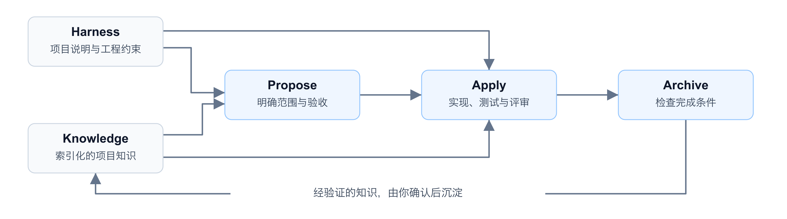
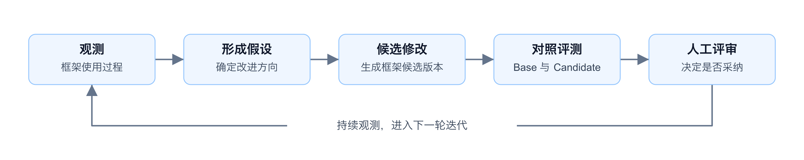

# AegisHarness

[English](README.md) | **简体中文**

> **Built to Adapt. Designed to Evolve.**
>
> 为适配而生，为进化而设计。让团队的工程 DNA，融入 AI 研发。

**AegisHarness 帮助团队在 Codex、Claude Code、MiniMax Code、WorkBuddy / CodeBuddy、Qoder 和 DeepSeek Harness (dsh) 上构建专属的 AI Coding Harness。** 将你的业务知识、工程规范与研发工作流带入 Agent 的工作过程，从需求分析、实现、测试、评审到归档，让 AI 按团队的方式开展研发，并将经验证的经验留在项目中，供下一个需求复用。

从插件开始即可。当你希望改进 Harness 本身时，可选的 **aegisharness-platform** 帮助框架维护者观测使用过程、对比框架版本，并在采纳候选改进前验证效果。

**9 个命令 · 6 个宿主（Codex / Claude Code / MiniMax Code / WorkBuddy / Qoder / DeepSeek Harness）· 单仓 / 多仓 Workspace · Apache-2.0**

[快速开始](#快速开始) · [命名故事](#名字背后的故事) · [框架亮点](#框架亮点) · [框架迭代平台](#围绕-aegisharness-框架的迭代平台) · [使用指南](docs/user-guide.zh-CN.md)

## 名字背后的故事

每个团队都有自己的研发方式：必须守住的业务规则、长期演进的技术架构、信赖的质量检查，以及一路积累的工程经验。它们共同构成了团队的 **Engineering DNA（工程 DNA）**。

**Aegis，意为守护之盾。** 它象征团队必须守住的业务规则、架构边界与来之不易的经验，让这些知识随项目传承、持续演进。**Harness，则让这些知识参与执行**：通过上下文、工程约束和工作流，引导 Coding Agent 完成真实项目中的研发任务。

AegisHarness 沉淀自真实的工程研发实践，作为公司级、宿主无关的标准研发 Harness，将这两个想法结合起来：用项目知识与规范适配团队，在归档中沉淀经验证的经验，为后续任务提供更好的起点；面向框架维护者，再通过观测与受控评测为下一次改进提供依据，由人决定是否采纳。

**交付代码，留下经验，演进 Harness。**

## 框架亮点

| 能力 | 对日常研发的价值 |
| --- | --- |
| **基于项目 Harness 的约束执行** | 将仓库原生说明与索引中的项目约束带入研发过程，让需求分析和实现有具体的工程规范可遵循。 |
| **知识复利** | 经验证的业务规则、接口边界和实现经验，可在归档时由你确认后沉淀，供后续需求继续复用。 |
| **按需加载上下文** | 通过 Harness 与知识索引，按当前需求、任务和归档范围读取相关文档，并随着工作推进重新判断所需上下文。 |
| **可检查的研发闭环** | Propose 明确范围与验收，Apply 完成实现、测试和评审，Archive 检查完成条件并归档；Spec、任务和证据留在仓库中。 |
| **跨会话、跨仓库协作** | 持久化工作流状态支持接着完成中断的任务；多仓 Workspace 记录各仓职责，协调跨服务研发。 |

这里的 **Harness**，指引导 Agent 工作的项目约束与执行规则：该读哪些信息、遵守哪些边界、达到什么证据要求才能完成。详见[上下文加载协议](aegisharness/reference/loading-protocol.md)。



### 让工程 DNA 参与执行

**把团队经验，变成 Agent 的工作上下文。** AegisHarness 将项目知识、工程约束、需求契约和检查机制组织在业务仓库中，与代码共同维护，让它们可以被评审、复用，并随项目持续更新。

| 组成 | 回答的问题 | 在业务项目中的位置 |
| --- | --- | --- |
| **Knowledge · 项目知识** | 系统如何运作？有哪些业务规则和历史决策？ | `docs/knowledge/` |
| **Harness · 工程约束** | 开发时应该遵守哪些规范与架构边界？ | `docs/harness/` |
| **Specs · 需求契约** | 这次要做什么，用什么证据证明已经完成？ | `docs/specs/` |
| **Hooks · 检查机制** | 在关键执行与评审节点，需要完成哪些检查？ | `docs/hooks/` 与宿主 hooks 配置 |

Knowledge 与 Harness 通过索引引导上下文加载，Specs 保存每个需求的范围、计划和验证证据。Hooks 包含宿主运行时钩子、工作流门禁和评审清单，具体执行方式由宿主与工作流配置决定。详见[上下文加载协议](aegisharness/reference/loading-protocol.md)与 [hooks 配置说明](docs/installation.md)。

### 知识复利如何发生

例如，第一次开发退款功能时，确认了退款状态流转规则和跨服务接口边界。实现与验证完成后，Archive 提出值得保留的稳定知识，由你确认后写入项目知识文档。下一次开发退款相关需求时，Propose 和 Apply 就能通过索引读取这些知识，在已有项目事实的基础上继续工作。

知识以**可评审的仓库文档**持续积累，由你决定哪些经验成为项目的共享知识。

**先从插件开始即可。** 插件可以独立使用，无需部署平台。[任务筛选示例](examples/README.md)提供起始项目、需求和独立验收脚本，可直接上手。

## 快速开始

### 1. 安装插件

需要 Python 3.10+、Git，以及支持插件市场或原生 Skill 发现的受支持宿主之一（见[宿主支持矩阵](docs/host-support-matrix.md)）。先确保宿主已完成登录或模型配置，能够正常使用；DeepSeek Harness 另需 Node.js 22.19+（或 24+）与 npm。

**按自己使用的宿主选择对应代码块**，每一段都是针对公开仓库、可直接复制执行的完整安装脚本。想测试本地改动时，把仓库地址换成本地 checkout 路径，见[开发者安装（本地源码）](docs/installation.md#developer-installation)。

**Codex**

```bash
codex plugin marketplace add https://github.com/eliterncn/aegisharness.git
codex plugin add aegis@aegisharness-marketplace
```

**Claude Code**

```bash
claude plugin marketplace add https://github.com/eliterncn/aegisharness.git
claude plugin install aegis@aegisharness-marketplace
```

**MiniMax Code**（preview）

```bash
mcode plugin marketplace add https://github.com/eliterncn/aegisharness.git
mcode plugin install aegis@aegisharness-marketplace
```

命令以 `hosts/minimax/skills/` 下的 Skill 薄入口投影。

**WorkBuddy / CodeBuddy**（preview）

```bash
codebuddy plugin marketplace add https://github.com/eliterncn/aegisharness.git
codebuddy plugin install aegis@aegisharness-marketplace
```

安装后执行 `/reload-plugins` 并新开会话。

**Qoder**（preview）

```bash
qodercli plugin marketplace add https://github.com/eliterncn/aegisharness.git
qodercli plugin install aegis@aegisharness-marketplace
```

桌面端也可在插件市场添加同一仓库地址。

**DeepSeek Harness (dsh)**（preview）

插件根同时就是 npm 包 `@eliterncn/aegisharness-dsh` 的包根：`package.json` 用 `dsh.bundle.patch` 声明 patch 层，`lib/index.js` 通过 `ctx.skills` 把九个命令注册成运行时 Skill。因此安装就是 DSH 自己的插件管理，不往 `$DSH_HOME/skills` 拷文件。

```bash
# 1) 安装 CLI（Node.js 22.19+ / 24+）
npm install -g @deepseek-ai/dsh

# 2) 安装 bundle；dsh 会把它写进 profile 的 dsh.profile.bundles
dsh plugin --profile web add @eliterncn/aegisharness-dsh

# 3) 确认组合树含该条目，再启动并新开会话
dsh --profile web --dump-config | grep -A1 aegisharness
dsh web
```

> `@eliterncn/aegisharness-dsh` 尚未在 npm 公开发布。首次发布前，把上面第 2 步换成 `file:` 本地路径安装：`dsh plugin --profile web add "file:/abs/path/to/aegisharness/aegisharness"`。

DSH 的 Skill 名只接受 kebab-case，因此 `/aegis:init` 在本宿主以 `/aegis-init` 触发。`file:` 开发者安装、skills 目录兜底方案与完整命令映射见 [dsh 安装说明](aegisharness/hosts/deepseek-dsh/installer.md)。

**无论哪个宿主**，若同一终端存在多个宿主的运行时标记，请显式绑定 Host Context：

```bash
export AEGISHARNESS_PLATFORM=<host-id>
python3 aegisharness/scripts/host_runtime_cli.py resolve --platform <host-id>
```

根市场会安装 `aegisharness/` 插件，不会安装平台。preview 宿主不安装 hooks、遥测与自动更新，详见[宿主支持矩阵](docs/host-support-matrix.md)；[hooks 检查、更新与卸载](docs/installation.md)见安装指南。

### 2. 完成一个小需求

在要开发的**业务仓库**新开 Agent 会话，通过宿主原生界面审阅插件 hooks，然后在对话中输入：

```text
/aegis:init
/aegis:propose task-filter ./requirements/task-filter.md --loop
```

[任务筛选示例](examples/README.md)提供起始项目、需求和独立验收脚本，可直接跟着操作。`--loop` 串联 Propose → Apply → Archive，遇到需要决策的问题或阻断时暂停，不包含代码发布或部署。

也可分别执行 `/aegis:propose`、`/aegis:apply` 和 `/aegis:archive`。详见[九个公开命令](docs/user-guide.zh-CN.md#命令参考)。

产品名称为 **AegisHarness**，插件 ID 和命令前缀使用 **`aegis`**。使用 `/aegis:status` 查看进度与阻塞，使用 `/aegis:config` 查看或修改统计授权和上报地址。

## 与 Superpowers、OpenSpec 的侧重点

这些项目都在探索如何更好地组织 Agent 研发，能力有所交集。这里对比各自的主要侧重点：

| 项目 | 主要侧重点 |
| --- | --- |
| [Superpowers](https://github.com/obra/superpowers) | 可组合的研发技能与方法，涵盖头脑风暴、计划、TDD、子 Agent 执行和代码评审。 |
| [OpenSpec](https://github.com/Fission-AI/OpenSpec) | 以规范驱动变更，通过 proposal、specs、design、tasks 对齐需求，再推进实现与归档。 |
| **AegisHarness** | 将项目 Harness 约束与可复用知识融入研发闭环，并提供可选平台，持续观测、评测和改进框架本身。 |

相关借鉴与归属说明见[第三方声明](THIRD_PARTY_NOTICES.md)。

## 围绕 AegisHarness 框架的迭代平台

**aegisharness-platform 面向修改 AegisHarness 命令、工作流规则、技能和上下文加载策略的框架维护者。** 它将使用证据、受控版本对比和候选改进串起来，为框架迭代提供依据。

| 能力 | 要回答的问题 | 可以查看什么 |
| --- | --- | --- |
| **可观测** | AegisHarness 在实际使用中哪里容易卡住？ | 工作流执行记录、阶段状态、耗时与 Token 用量、返工和证据质量。 |
| **可评测** | 这次修改是否让 AegisHarness 框架变得更好？ | 冻结 Base 与 Candidate，在同一组 Case 下执行，对照结果、回归门禁和执行证据。 |
| **可自进化** | 下一步值得尝试怎样的框架改进？ | 基于证据形成假设，生成隔离的候选修改，冻结后进入实验，由人评审并决定是否采纳。 |

**评测对象是 AegisHarness 框架的版本或修改。** 开发场景用于驱动框架运行，场景中的结果是判断框架行为的证据。这套平台服务于框架自身迭代，不是通用的业务代码生成质量评测服务。



### 三个视角看框架迭代

| 视图 | 可查看的内容 |
| --- | --- |
| **可观测** | 定位工作流摩擦、阶段状态、耗时与 Token 用量、返工与证据质量。 |
| **可评测** | 冻结的 Base 与 Candidate 版本跑同一批 Cases，查看回归闸门与执行证据。 |
| **可自进化** | 证据驱动的假设、隔离的候选改动，以及可审阅的人工采纳决策。 |

运行 Demo（`python -m web_ui.demo --port 7860`）后打开 `localhost:7860` 即可查看这三个视图。
内置数据为合成演示数据，界面示例不代表实测改进或真实模型结果。

三个视图均使用**合成演示数据**：评测采用 Mock 执行，自进化页面展示证据闭环与合成证据概览。它们用于展示功能，不代表实际改进收益或真实模型表现。

真实评测需要自己的模型服务和已校准 Case。自进化的假设与候选修改可供审阅，框架修改的采纳与发布由人决定。

### 体验平台 Demo

先下载或克隆源码，再从包含两个子项目的仓库根目录执行：

macOS / Linux（Bash / Zsh）：

```bash
cd aegisharness-platform
python3 -m venv .venv
source .venv/bin/activate
python -m pip install -e ".[server]"
python -m web_ui.demo --port 7860
```

Windows（PowerShell）：

```powershell
cd aegisharness-platform
py -m venv .venv
.\.venv\Scripts\Activate.ps1
python -m pip install -e ".[server]"
python -m web_ui.demo --port 7860
```

如果使用 Windows CMD，将 PowerShell 的激活命令替换为 `.venv\Scripts\activate.bat`，其余 Windows 命令相同。

打开 [localhost:7860](http://127.0.0.1:7860)。Demo 从随附的合成源码示例生成 Case、Mock Run 和遥测数据，默认在临时目录中生成各模块独立的运行数据库，并关闭后台自进化和模型分析。生成的数据库、验收测试 Run 和候选工作区不随源码或 wheel 分发。内置 Demo 默认不生成进化假设；自进化页面展示尚未生成假设和候选的总览。

## 仓库结构

| 目录 | 职责 |
| --- | --- |
| [`aegisharness/`](aegisharness/README.md) | Agent 插件、命令、宿主适配与运行时测试 |
| [`aegisharness-platform/`](aegisharness-platform/README.md) | 面向 AegisHarness 框架的可选观测、评测与自进化平台 |
| [`examples/`](examples/README.md) | 可复现的起始项目及可观察的验收要求 |
| [`docs/`](docs/user-guide.zh-CN.md) | 配置、工作流、故障排查与验证边界 |

做版本评测时，将平台指向源码 Git 仓库或其内部目录。平台会从每个冻结提交中独立定位插件，支持独立、组合及多层嵌套布局；存在多个插件副本时需显式指定相对 Git 根目录的路径，无需再初始化嵌套仓库。详见[评测配置](docs/user-guide.zh-CN.md#版本评测)。

## 数据与反馈

统计需要用户明确开启。异步上报和可选反馈功能**默认没有平台地址**；未配置目的地时保留入口，但不能发送反馈。配置地址不等于同意发送，每次反馈内容和实际目的地仍需授权。

普通社区问题直接提交到 [GitHub Issues](https://github.com/eliterncn/aegisharness/issues)，不需要先部署平台。漏洞按[安全政策](SECURITY.md)私密报告。详见[数据与反馈说明](docs/user-guide.zh-CN.md#问题反馈)。

## 路线图

接下来计划围绕两个方向，让更多团队按自己的研发方式使用 AegisHarness：

- **支持更多 Coding Agent**：Host Kit 由清单驱动，接入新宿主参见[新增宿主指南](docs/add-new-host.md)。
- **支持工作流配置**：允许团队配置工作流阶段及其顺序，适配自身的研发流程。

以上为规划能力。当前版本已提供六个 Host Kit，宿主支持范围参见[宿主支持矩阵](docs/host-support-matrix.md)；工作流仍为 Propose → Apply → Archive。欢迎通过[贡献指南](CONTRIBUTING.md)分享具体使用场景，帮助完善这些方向。

## 文档与贡献

- [安装与更新](docs/installation.md)
- [宿主支持矩阵](docs/host-support-matrix.md) · [新增宿主指南](docs/add-new-host.md)
- [改造说明](MIGRATION-NOTES.md) · [来源声明](ATTRIBUTION.md)
- [完整中文指南](docs/user-guide.zh-CN.md) · [English guide](docs/user-guide.md)
- [开发与贡献](CONTRIBUTING.md) · [社区行为准则](CODE_OF_CONDUCT.md)

源码版本：**AegisHarness 1.0.0 · aegisharness-platform 1.0.0**。源码中的版本号不代表 GitHub 仓库或 Release 已公开发布。

## 开源协议

采用 [Apache License 2.0](LICENSE)。版权和第三方组件声明见 [NOTICE](NOTICE) 与[第三方声明](THIRD_PARTY_NOTICES.md)。
